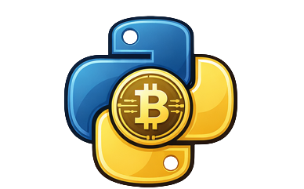

# 🪙 WobblyToken

<p align="center">
  
</p>

<p align="center">
  Une simulation de cryptomonnaie en Python pour comprendre les blocs,
  le minage, les transactions et les échanges entre nœuds.
</p>

<p align="center">
  
  
  
  
</p>

<p align="center">
  
  
  
</p>

## Présentation

WobblyToken est un projet pédagogique réalisé dans le cadre d’un travail
de maturité consacré à la création d’une cryptomonnaie en Python.

L’objectif est de rendre les mécanismes d’une blockchain accessibles
à travers une simulation et du code lisible.

Ce README décrit la branche **`main`**. Le projet reste un prototype
destiné à l’apprentissage et aux essais locaux.

📘 [Fiche pour comprendre les notions Python de WobblyToken](FICHE_PYTHON_WOBBLYTOKEN.md)

## Fonctionnalités

- Création de blocs liés par leur hash.
- Minage par **Proof of Work avec SHA-256**.
- Ajustement de la difficulté tous les 5 blocs, avec une cible de
  10 secondes de minage par bloc.
- Récompense initiale de 50 unités, divisée par deux tous les 10 blocs,
  avec un minimum d’une unité élémentaire.
- Transactions suivant un modèle **UTXO**.
- Signatures **ECDSA sur la courbe secp256k1**.
- Création ou chargement automatique du portefeuille de chaque nœud.
- Mempool contenant les transactions en attente.
- Validation des blocs reçus et des transactions.
- Diffusion des transactions entre pairs et envoi des blocs minés aux voisins.
- Synchronisation avec une chaîne plus longue après validation.
- Interface web et API HTTP.
- Benchmarks séparés en Python, Rust, Rust multicœur et Rust avec WGSL sur GPU.

## Organisation du réseau

La configuration Docker Compose lance **quatre services** :

| Service | Rôle | Accès depuis l’ordinateur |
|---|---|---|
| `node1` | Premier nœud | http://localhost:5001 |
| `node2` | Deuxième nœud | http://localhost:5002 |
| `node3` | Troisième nœud | http://localhost:5003 |
| `registry` | Registre des nœuds utilisant SQLite | http://localhost:6001 |

Les nœuds s’enregistrent auprès du registre, qui leur attribue leurs
voisins selon une organisation en anneau. Ils échangent ensuite
directement par HTTP.

Le registre sert à découvrir les voisins : il ne valide pas les blocs
et ne conserve pas la blockchain.

## Installation et lancement

### Prérequis

- Git.
- Docker et Docker Compose disponibles.
- Les ports `5001`, `5002`, `5003` et `6001` libres.

Python et les bibliothèques de la simulation sont installés dans les images
Docker : il n’est pas nécessaire de les installer séparément sur l’hôte.

### Démarrer la simulation

```bash
git clone https://github.com/MeuxyVex/WobblyToken.git
cd WobblyToken/blockchain-simulation
docker compose up --build
```

Ouvrir ensuite les interfaces :

- [Nœud 1](http://localhost:5001/)
- [Nœud 2](http://localhost:5002/)
- [Nœud 3](http://localhost:5003/)

### Arrêter la simulation

Depuis le dossier `blockchain-simulation` :

```bash
docker compose down
```

Les volumes des portefeuilles et du registre sont conservés.
La blockchain et la mempool restent en mémoire : elles ne sont pas
sauvegardées sur disque par cette version.

## Première transaction

1. Ouvrir les interfaces des nœuds 1 et 2.
2. Miner un bloc sur le nœud 1 pour obtenir une récompense.
3. Récupérer l’adresse du portefeuille du nœud 2.
4. Depuis le nœud 1, envoyer une transaction vers cette adresse.
5. Miner un nouveau bloc pour inclure la transaction.
6. Vérifier les soldes et les chaînes des nœuds.

Le portefeuille est préparé automatiquement au démarrage.
La route `/send` construit et signe la transaction avec le portefeuille
du nœud : il n’est donc pas nécessaire de signer manuellement pour utiliser
cette fonctionnalité.

## Utilisation avec curl

Exemples pour Bash et les shells compatibles.

### Consulter le portefeuille du nœud 2

```bash
curl http://localhost:5002/wallet
```

Copier la valeur du champ `address` pour l’utiliser comme destinataire.

### Miner sur le nœud 1

```bash
curl http://localhost:5001/mine
```

La requête attend la fin du minage.

### Envoyer une unité de WobblyToken

```bash
curl -X POST http://localhost:5001/send \
  -H "Content-Type: application/json" \
  -d '{"address":"ADRESSE_DU_NOEUD_2","amount":100000000}'
```

Remplacer `ADRESSE_DU_NOEUD_2` par l’adresse réelle.

**L’API utilise des montants entiers en unités élémentaires :
1 WobblyToken = 100 000 000 unités élémentaires.**

### Consulter les transactions en attente et les blocs

```bash
curl http://localhost:5001/transaction
curl http://localhost:5001/chain
```

### Confirmer la transaction et synchroniser le nœud 2

```bash
curl http://localhost:5001/mine
curl http://localhost:5002/sync
```

## API des nœuds

Remplacer le port `5001` par `5002` ou `5003` pour interroger un autre nœud.

| Méthode | Route | Fonction |
|---|---|---|
| GET | `/` | Afficher l’interface web |
| GET | `/wallet` | Consulter l’adresse et la clé publique du portefeuille |
| GET | `/balance/<address>` | Consulter le solde confirmé d’une adresse |
| GET | `/utxos` | Consulter les sorties non dépensées |
| GET | `/transaction` | Consulter la mempool |
| POST | `/send` | Construire, signer et diffuser une transaction depuis le portefeuille local |
| POST | `/transaction` | Soumettre une transaction complète déjà signée |
| POST | `/receive_transaction` | Recevoir et relayer une transaction transmise par un pair |
| GET | `/mine` | Miner un bloc et l’envoyer aux voisins |
| POST | `/receive_block` | Vérifier et ajouter un bloc reçu |
| GET | `/chain` | Consulter la blockchain locale |
| GET | `/sync` | Rechercher une chaîne valide plus longue auprès des voisins |
| GET | `/network` | Consulter les informations du réseau |

## Organisation du dépôt

| Chemin | Contenu |
|---|---|
| `blockchain-simulation/Noeuds/` | Code Python des nœuds |
| `blockchain-simulation/Noeuds/wallet/` | Gestion des clés, des adresses et du stockage des portefeuilles |
| `blockchain-simulation/Noeuds/templates/` | Interface web |
| `blockchain-simulation/Database/` | Service d’enregistrement et registre SQLite |
| `blockchain-simulation/docker-compose.yml` | Configuration des services Docker |
| `benchmark/` | Programmes de comparaison des performances |
| `src/` | Ressources visuelles du dépôt |

## Benchmarks

Les programmes de `benchmark/` explorent plusieurs implémentations :

- `benchmark.py` : Python.
- `benchmark_rust/` : Rust sur CPU.
- `benchmark_rust_multicoeur/` : Rust avec calcul parallèle sur CPU.
- `benchmark_rust+wgsl/` : Rust et wgpu avec un shader WGSL sur GPU.

Ces programmes sont des essais séparés : ils ne remplacent pas
automatiquement le mineur Python des nœuds.

Les versions Rust nécessitent Rust et Cargo. La version GPU nécessite
également un périphérique et des pilotes compatibles avec wgpu.

## Limites actuelles

- Le réseau dépend d’un registre central pour obtenir les voisins.
- La synchronisation privilégie le nombre de blocs, pas le travail cumulé.
- La blockchain et la mempool sont conservées en mémoire.
- Le déploiement utilise le serveur de développement Flask.
- Les routes de contrôle du portefeuille ne disposent pas d’authentification :
  conserver la simulation dans un environnement de test contrôlé.
- Les benchmarks ne constituent pas une garantie de sécurité du protocole.

La branche `main` présentée ici ne comprend pas de déploiement Kubernetes,
de transport pair-à-pair par sockets TCP ni de moteur de smart contracts.

## Licence

Projet distribué sous licence [MIT](LICENSE).
